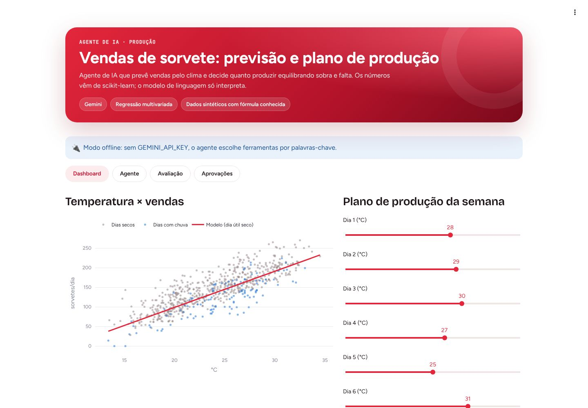
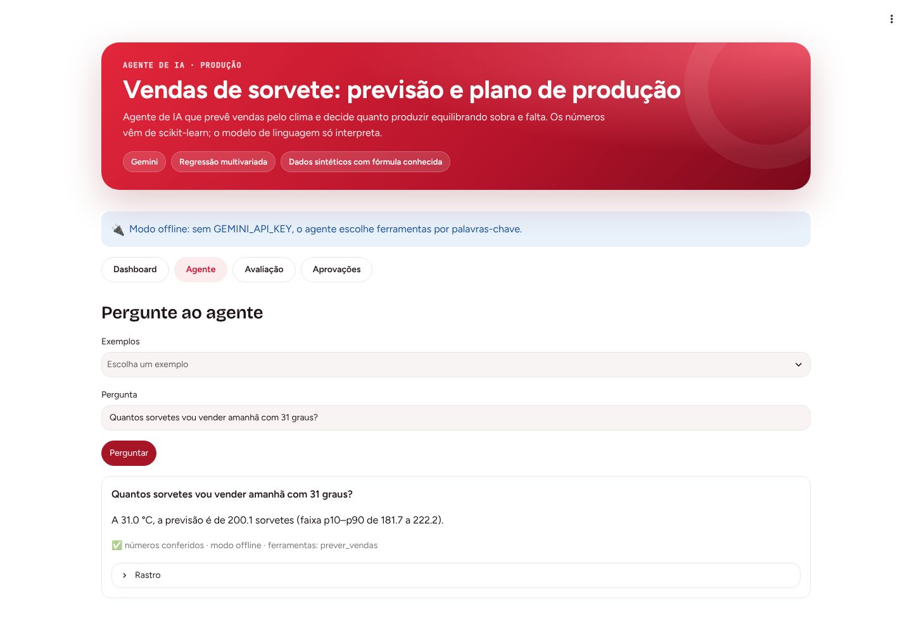

# Agente de vendas de sorvete · previsão e plano de produção

Agente de IA que prevê quantos sorvetes serão vendidos a partir do clima e decide quanto produzir em cada dia da semana, equilibrando o custo de sobrar com o custo de faltar. A ordem de produção só vai para a fábrica com aprovação humana.

O projeto começou como uma regressão linear simples de vendas por temperatura. Esta versão adiciona chuva, fim de semana e feriado ao modelo, um plano de produção, rastreamento de experimentos e um agente com dashboard.



## Como funciona
**O modelo interpreta, o código calcula e confere, a pessoa aprova.**

1. O Gemini lê a pergunta e escolhe as ferramentas, com saída em JSON Schema.
2. As contas são do scikit-learn. O modelo de linguagem nunca calcula.
3. O código confere se cada número da resposta saiu de uma ferramenta. Se algum não saiu, a resposta vira **revisar**.
4. `confirmar_producao` é sensível: fica pendente até ser aprovada no painel.

Sem `GEMINI_API_KEY`, o agente roda em modo offline, com roteamento por palavras-chave.

| Ferramenta | O que faz |
|---|---|
| `prever_vendas` | Vendas de um dia, com faixa p10–p90, a partir de temperatura, chuva, fim de semana e feriado |
| `planejar_producao` | Quanto produzir por dia (modelo *newsvendor*: produz no quantil crítico falta/(falta+sobra)) |
| `explicar_modelo` | Efeito de cada grau, da chuva, do fim de semana e do feriado |
| `comparar_modelos` | Só temperatura × multivariado, em holdout temporal |
| `registrar_experimento` | Grava a comparação em CSV e, com o extra `[mlflow]`, também no MLflow (backend SQLite) |
| `confirmar_producao` | Sensível: envia a ordem de produção |

## Resultados medidos
Holdout temporal com os últimos 147 dias (20% da série):

| Modelo | R² | MAE (sorvetes/dia) |
|---|---|---|
| Só temperatura (o modelo original) | 0,581 | 21,35 |
| **Multivariado** | **0,870** | **12,76** |

Coeficientes recuperados contra os valores reais da fórmula:

| Efeito | Real | Recuperado |
|---|---|---|
| Por grau | 9,00 | 9,22 |
| Chuva | −35,00 | −33,53 |
| Fim de semana | +40,00 | +41,42 |

A avaliação contra gabarito (`python eval/run_eval.py`) acertou **17 de 17 casos**:
- coeficientes dentro da tolerância;
- R² do multivariado ≥ 0,85;
- previsão nunca negativa;
- produção maior quando faltar custa mais;
- 9 perguntas roteadas para a ferramenta certa, com a confirmação da ordem retida para aprovação;
- número inventado barrado.

O detalhe de cada caso está em [`eval/resultados.md`](eval/resultados.md).

## Limites
- **Os dados são sintéticos.** O projeto original não tinha base de dados. A série de 2023–2024 foi gerada por uma fórmula conhecida ([`data/parametros_reais.json`](data/parametros_reais.json)) para permitir o gabarito. Vendas reais têm efeitos não lineares (calor extremo, eventos, preço) que este modelo linear não captura.
- A previsão depende da temperatura informada. A integração com uma API de previsão do tempo não foi feita.
- O roteamento offline é por palavras-chave. A escolha de ferramentas com o Gemini real ainda não foi medida: rode o workflow manual `eval-gemini` com o secret `GEMINI_API_KEY`.
- O Flask citado na versão antiga foi substituído pelo Streamlit.

## Como rodar
```bash
pip install -e ".[dev]"            # ou ".[dev,mlflow]" para registrar no MLflow
streamlit run app/streamlit_app.py   # dashboard + agente
python eval/run_eval.py              # avaliação contra gabarito
pytest -q                            # testes, sem rede
```



## Estrutura
```
src/sorveteagent/
  agentcore.py   cliente Gemini, laço de ferramentas, conferência de números, aprovações
  data.py        gerador da série (fórmula conhecida)
  models.py      regressões, holdout, plano newsvendor, registro de experimentos
  tools.py       ferramentas do agente e roteamento offline
app/streamlit_app.py   Dashboard · Agente · Avaliação · Aprovações
eval/run_eval.py       gabarito
```
